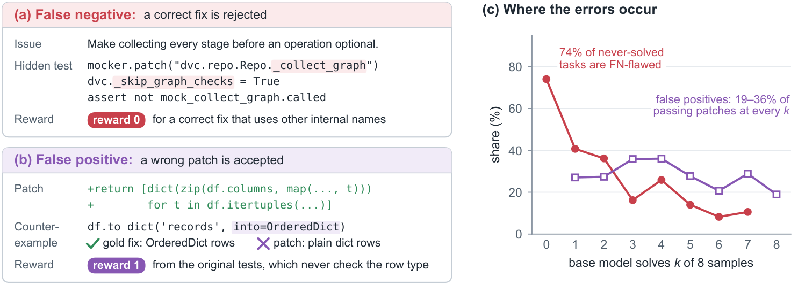

<h1 align="center">SWE-Gym-Verified</h1>

<p align="center">
  <b>What Makes Good Data for Training Coding Agents? A Systematic Study on SWE-Gym</b>
</p>

<p align="center">
  Yikai&nbsp;Zhang<sup>1</sup>, Mai&nbsp;Xu<sup>2</sup>, Yunbei&nbsp;Zhang<sup>3</sup>, Qirui&nbsp;Jin<sup>4</sup>, Kenan&nbsp;Li<sup>5</sup>, Yuwen&nbsp;Jia<sup>6</sup>,<br>
  Jinwei&nbsp;Yao<sup>1</sup>, Xiangyu&nbsp;Zhang<sup>1</sup>, Jielun&nbsp;Tan<sup>1</sup>, Jin&nbsp;Pan<sup>1</sup>, Zijian&nbsp;Jin<sup>7</sup>, Xiao&nbsp;Sun<sup>1</sup>
</p>

<p align="center">
  <sup>1</sup>AMD &nbsp; <sup>2</sup>University&nbsp;of&nbsp;Michigan &nbsp; <sup>3</sup>Tulane&nbsp;University &nbsp; <sup>4</sup>Georgia&nbsp;Institute&nbsp;of&nbsp;Technology<br>
  <sup>5</sup>University&nbsp;College&nbsp;London &nbsp; <sup>6</sup>University&nbsp;of&nbsp;California,&nbsp;Los&nbsp;Angeles &nbsp; <sup>7</sup>New&nbsp;York&nbsp;University
</p>

<p align="center">
  <a href="#citation"></a>
  <a href="https://arist12.github.io/writing/swe-gym-verified/"></a>
  <a href="https://huggingface.co/datasets/Arist12/SWE-Gym-Verified"></a>
  <a href="LICENSE"></a>
</p>

<p align="center">
  
</p>

Reinforcement learning trains coding agents on software tasks whose hidden tests decide the reward, so the tests are
the labels of RL. They can be wrong in two ways: a **false negative** is a correct fix that the tests reject, and a
**false positive** is a wrong patch that the tests accept. We audit the hidden tests of
[SWE-Gym](https://huggingface.co/datasets/SWE-Gym/SWE-Gym) for both errors with Claude Opus 5.5 and GPT-6.1 Sol, with
every suspected error reproduced by execution, and then test in controlled RL experiments what the errors do to
training.

- **Unsolved often means mislabelled.** 74% of the tasks that a 9B base model never solves have a test that rejects
  correct fixes, compared with 20% of those it sometimes solves. About a quarter of all passing patches are false positives.
- **Pass-rate filters keep the label errors that train the policy.** Dropping never-solved tasks removes flawed tasks
  that yield almost no gradient. The flawed tasks that remain supply a fifth of the groups that carry gradient.
- **Audited data scores higher.** At equal size and matched difficulty, models trained on audited tasks score 2.4 and
  2.7 points higher on held-out SWE-bench Verified and SWE-bench Pro tasks than models trained on the original tasks.
  A pass-rate filter shows no such gain.
- **Hardening against false positives lowers the training reward without a detectable held-out change.**

A [blog post](https://arist12.github.io/writing/swe-gym-verified/) walks through the results and case studies, and the
paper has the details.

## What is released

| what | where |
|---|---|
| **Dataset**: 1,087 audited tasks, and for every audited SWE-Gym task the verdict with its evidence | [Hugging Face](https://huggingface.co/datasets/Arist12/SWE-Gym-Verified) |
| **Audit workflow**: the pipeline that produced the dataset, with its prompts | [`taskaudit/`](taskaudit/), guide in [`docs/WORKFLOW.md`](docs/WORKFLOW.md) |
| **Experiment files**: the four training sets, how they were drawn, configs, every held-out result | [`experiments/`](experiments/) |

## Dataset

```python
from datasets import load_dataset

# the 1,087 released tasks
tasks = load_dataset("Arist12/SWE-Gym-Verified", "tasks", split="train")
# the 708 tasks that Qwen3.5-9B does not always solve
trainable = tasks.filter(lambda t: t["base_resolved_of_8"] < 8)
```

Loading by repository id needs `datasets>=4.7`. The
[data card](https://huggingface.co/datasets/Arist12/SWE-Gym-Verified) describes the six tables, how to rebuild runnable
tasks from public SWE-Gym, and how to get the paper's training sets. The dataset is meant for training and for studying
reward errors, not for evaluation.

## Audit workflow

`taskaudit` runs the audit on SWE-bench-format Python tasks with a Docker image per task. It has been run on SWE-Gym;
other collections in this format (SWE-bench and its Python variants, or your own) are supported by configuration and
are untested.

```bash
git clone https://github.com/Arist12/SWE-Gym-Verified.git && cd SWE-Gym-Verified
# needs uv (https://docs.astral.sh/uv/); installs the SWE-Gym fork of the SWE-bench harness
uv sync --extra swegym

export TASKAUDIT_WORK=$PWD/work
uv run taskaudit run --config configs/swegym.yaml --stage prescreen,environment \
  --ids pydantic__pydantic-8650,facebookresearch__hydra-2062
```

[`docs/WORKFLOW.md`](docs/WORKFLOW.md) covers the stages, the outputs, real LLM calls and other task collections;
[`docs/FIDELITY.md`](docs/FIDELITY.md) says what is identical to the paper's runs.

## Experiments

[`experiments/`](experiments/) holds the four training sets (Orig, Orig+Filter, Clean, Clean+FP) with the samplers
that redraw them, the GRPO and SWE-agent configs, and the outcome of every held-out attempt. Training code and model
weights are not released. See [`experiments/README.md`](experiments/README.md).

## Repository layout

| path | contents |
|---|---|
| [`taskaudit/`](taskaudit/), [`configs/`](configs/) | the audit workflow: package and command line, configs |
| [`experiments/`](experiments/) | training sets, samplers, training and evaluation configs, held-out results |
| [`docs/`](docs/) | the workflow guide and notes |
| [`assets/`](assets/) | the figure on this page |

## Citation

The paper will appear on arXiv; the BibTeX entry will be added here.

## License

Our code and our additions to the tasks are released under the [Apache License 2.0](LICENSE). The upstream tasks keep the
terms of their sources; see [`docs/THIRD_PARTY.md`](docs/THIRD_PARTY.md) and the dataset's
[`NOTICE.md`](https://huggingface.co/datasets/Arist12/SWE-Gym-Verified/blob/main/NOTICE.md).
